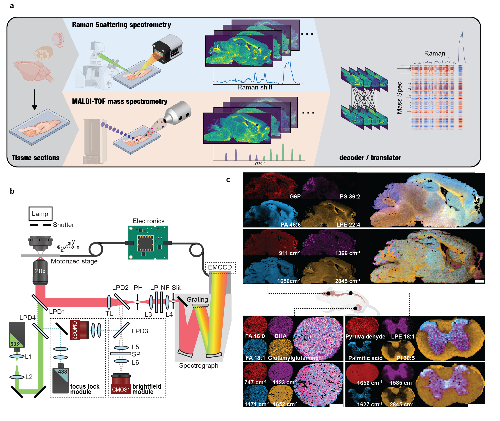

# Molecular Code of Biological Raman Spectroscopy

This repository contains the computational code associated with the study *Molecular Code of Biological Raman Spectroscopy*.

## Overview

Raman spectroscopy provides label-free measurements of molecular vibrations in biological specimens, but assigning overlapping Raman signals to individual molecular species remains challenging. In this study, spatially paired Raman measurements and matrix-assisted laser desorption/ionization mass spectrometry imaging (MALDI-MSI) are used to investigate the molecular information encoded in biological Raman spectra.

The computational framework examines the relationship between Raman spectral features and MALDI-derived molecular profiles in two directions: predicting Raman spectra from molecular measurements (**Decoder**) and predicting molecular profiles from Raman spectra (**Translator**).

## Experimental and computational framework



*Fig. 1 | Experimental workflow, Raman imaging instrumentation, and representative molecular and spectral images from biological tissues.*

## Computational methods

### Decoder: molecular-to-spectral mapping

The Decoder uses paired MALDI and Raman measurements to fit a ridge regression model that maps molecular abundance features to Raman spectral features. The fitted model can be applied to an independent dataset with the same molecular feature definitions to predict its Raman spectra.

- **Input:** MALDI molecular abundance matrix
- **Target:** Raman spectral intensity matrix

### Translator: spectral-to-molecular mapping

The Translator fits the reverse mapping, using Raman spectral features to predict MALDI molecular abundance features. The model can be evaluated on an independent, spatially paired Raman–MALDI dataset.

- **Input:** Raman spectral intensity matrix
- **Target:** MALDI molecular abundance matrix

Both scripts implement model fitting, prediction, and evaluation from user-supplied paired data. They use ridge regression with a default regularization strength of `alpha=0.01` and report correlation-based metrics, R², and spatial SSIM when coordinates permit. SSIM uses only complete 7 × 7 neighborhoods of measured pixels; unmeasured locations are excluded. Raw-data preprocessing and spatial registration are outside the scope of this repository.

## Repository contents

```text
Molecule-Raman/
├── README.md
├── Fig1.png
├── decoder.py
├── translator.py
└── requirements.txt
```

- `decoder.py`: MALDI-to-Raman regression workflow
- `translator.py`: Raman-to-MALDI regression workflow
- `Fig1.png`: Experimental and computational overview
- `requirements.txt`: Python package dependencies

The paired spinal cord example datasets are distributed as **GitHub Release assets**, rather than files tracked within the source repository.

## Installation

```bash
git clone https://github.com/MinLab-Columbia/Molecule-Raman.git
cd Molecule-Raman
pip install -r requirements.txt
```

## Example paired datasets

Two spatially paired spinal cord Raman–MALDI datasets are available in the [example-data-v1 release](https://github.com/MinLab-Columbia/Molecule-Raman/releases/tag/example-data-v1):

| Dataset | Download |
| --- | --- |
| `SpinalCord04.h5` | [Download HDF5](https://github.com/MinLab-Columbia/Molecule-Raman/releases/download/example-data-v1/SpinalCord04.h5) |
| `SpinalCord08_.h5` | [Download HDF5](https://github.com/MinLab-Columbia/Molecule-Raman/releases/download/example-data-v1/SpinalCord08_.h5) |

Download the files from the Release page and place them in a local `data/` directory inside the cloned repository. Release assets are not included when cloning the repository.

## Input data

The scripts accept preprocessed, spatially paired Raman and MALDI measurements in HDF5 (`.h5`) files. Each file must contain:

| HDF5 dataset | Contents | Shape |
| --- | --- | --- |
| `maldi_matrix` | Molecular abundance measurements | `(n_pixels, n_maldi_features)` |
| `raman_matrix_median` | Raman spectral intensities | `(n_pixels, n_raman_features)` |

Optional `x_coords` and `y_coords` datasets, each with one coordinate per measured pixel, enable spatial SSIM evaluation. Rows in the Raman and MALDI matrices must represent corresponding spatial locations. Training and test datasets must have the same feature identities and order within each modality; matching feature counts alone is insufficient.

## Usage

Both scripts fit a regression model to one paired HDF5 dataset and evaluate predictions on a separate paired HDF5 dataset. After downloading the two example files to `data/`, the following commands illustrate the workflow **provided the files use compatible Raman and MALDI feature definitions**:

**Molecular-to-spectral decoding**

```bash
python decoder.py --train data/SpinalCord04.h5 --test data/SpinalCord08_.h5
```

**Spectral-to-molecular translation**

```bash
python translator.py --train data/SpinalCord04.h5 --test data/SpinalCord08_.h5
```

Both scripts support `--alpha` (default `0.01`), `--output-dir`, and `--skip-ssim`. Results are written to `decoder_results/` or `translator_results/` by default, including predicted feature matrices, fitted coefficients, and evaluation metrics. No pretrained model weights are required or included.

## Data availability

The example paired spinal cord datasets can be downloaded from the [GitHub Releases page](https://github.com/MinLab-Columbia/Molecule-Raman/releases/tag/example-data-v1). The complete experimental Raman and MALDI datasets are not hosted here because of their size. The repository provides the core computational workflows rather than the full raw-data preprocessing, spatial registration, and figure-generation pipeline. Availability of the data supporting the study is described in the manuscript's Data Availability statement.
